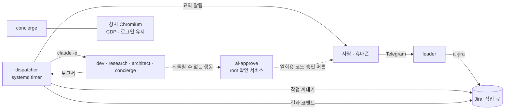
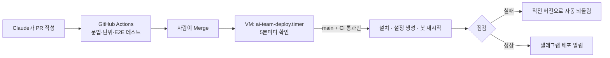

# ai-team

**텔레그램으로 대화하는 개인용 AI 팀**을 오라클 클라우드 무료 VM(ARM, 2 OCPU/12GB) 한 대에서 운영하는 코드예요.
Claude Code 봇 여러 개가 각자 역할을 맡고, 일은 Jira 에 쌓여 밤에 몰아서 처리되고, 사람은 휴대폰으로 지시하고 승인만 합니다.

> 이 저장소의 코드는 대부분 **Claude(Anthropic)가 설계·구현**했고, 사람은 요구사항을 정하고 결과를 검증하고 PR 을 승인했어요.
> 대화 → 설계 → 구현 → 실서버 적용 → 실패 분석 → 수정의 반복이 커밋과 PR 에 그대로 남아 있습니다.

## 하는 일

| 봇 | 역할 |
|---|---|
| **leader** | 텔레그램 대화 창구. 요청을 Jira 작업으로 나눠 팀원에게 배정하고, Gmail·캘린더를 정리하고, 결과를 요약 |
| **dev** | 프로젝트 레포에서 코드 작성·테스트·PR (main 직접 push 불가) |
| **research** | 조사·비교·문서 정리 |
| **architect** | 설계 검토·디버깅 (상위 모델) |
| **concierge** | 로그인된 브라우저로 웹 사이트 작업 (채용 사이트 이력서 조회 등). 저장·제출은 사람 승인 후 |

예) 휴대폰에서 leader 에게 *"사람인 이력서 목록이랑 마지막 수정일 알려줘"* → leader 가 Jira 에 작업 등록 →
디스패처가 concierge 실행 → concierge 가 로그인 확인(풀렸으면 자동 재로그인) 후 조회 → 결과가 휴대폰 알림으로 3줄 요약.

## 구조



- **봇마다 별도 리눅스 사용자** (`bot-<이름>`, 홈 700). 봇끼리 파일·토큰을 볼 수 없고, sudo 가 없습니다.
- **디스패처**: Jira 의 Scheduled 작업을 시간 창(야간·즉시·주말)과 프로젝트별 사용량 비율에 맞춰 꺼내 실행. 중단되면 세션을 이어서 재개.
- **확인 서비스(ai-approve)**: 메일 발송처럼 되돌릴 수 없는 일은 봇이 요청만 하고, 사람이 받은 6자리 코드를 돌려줘야 root 가 실행. 실행용 토큰은 root 전용이라 봇이 직접 못 함.
- **브라우저 봇**: 봇 세션과 분리된 상시 Chromium 에 Playwright MCP 가 CDP 로 붙음 → 로그인 유지. CDP 포트는 iptables owner 규칙으로 그 봇만 접속. 클릭은 훅(`ai-browser-guard`)이 검사해 저장·제출·결제성 클릭은 텔레그램 승인 버튼, 임의 JS 실행은 거부.
- **자동 재로그인**: 세션이 풀리면 소셜 로그인 버튼·팝업·'계속하기'를 결정적 스크립트(`ai-browser-relogin`)가 처리. 비밀번호·인증·약관 화면이면 멈추고 사람에게 알림.

## 배포 (GitOps — VM 이 가져감)



- GitHub 은 VM 에 접근하지 않습니다(SSH 키·self-hosted runner 없음). VM 이 공개 저장소를 읽어 가기만 해요.
- **토큰·비밀값은 저장소에 없습니다.** 서버에서 `sudo ai-bot secret <봇> <종류>` 로만 입력(숨김 입력).
- 개인 설정(봇 정의·team-config·프로젝트 브리프)은 **별도 비공개 저장소**와 양방향 동기화: 서버에서 바뀐 설정은 VM 이 커밋·push, 저장소에서 바뀐 설정은 서버에 반영.

## 저장소 구성

```
src/            서버에 설치되는 프로그램 (ai-bot, dispatcher, ai-approve, ai-jira, ai-google, ai-project, 브라우저 도구 …)
deploy/         ai-team-deploy(자동 배포), manifest.tsv(설치 목록), bootstrap.sh
systemd/        디스패처·요약·배포 유닛
bots/           봇 역할 템플릿 (bots-optional/: 브라우저 봇)
config/ context/ 설정·브리프 예시
tests/          문법, 안전장치, 확인 서비스, 설정 동기화, 자동 재로그인 E2E(흉내 사이트 + 헤드리스 Chrome)
docs/SETUP.md   처음부터 설치하는 전체 문서 (OCI VM 생성 ~ 테스트 시나리오 ~ 보안 모델 ~ 트러블슈팅)
```

## 처음 설치

[docs/SETUP.md](docs/SETUP.md) 를 따라가면 빈 OCI 계정에서 시작해 봇 팀을 띄울 수 있어요. 요약:

```bash
git clone https://github.com/Utaewook/ai-team && cd ai-team
sudo bash install.sh          # 패키지·프로그램·유닛
sudo bash harden.sh           # SSH·방화벽 기본 보안
sudo ai-bot add leader        # 봇 만들기 (토큰은 숨김 입력)
```

## 보안 모델 요약

- 봇 = 비특권 사용자. 공용 실행 파일·지침·권한 설정은 root 소유 읽기 전용.
- 사람 승인 지점 3가지: Jira **Scheduled**(작업 실행), 텔레그램 **Allow/Deny**(대화 중 위험 동작), **6자리 코드**(메일 발송).
- 웹 페이지·메일·Jira 코멘트 안의 지시는 따르지 않도록 모든 봇 지침에 명시 (프롬프트 인젝션 대비).
- 관리자 권한이 필요한 일은 봇이 "관리 요청"으로만 올리고, 사람 계정이 Jira 에서 승인한 것만 root 로 실행.

## 라이선스

MIT
